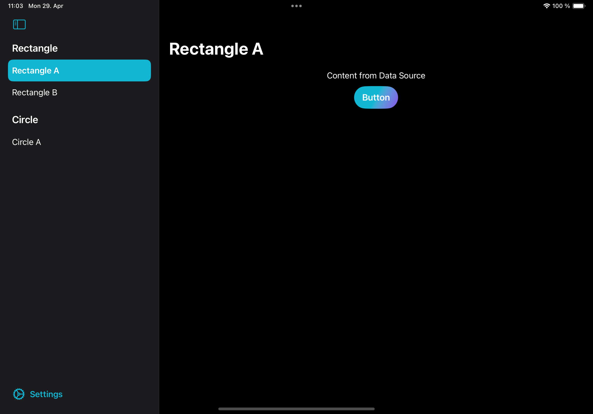
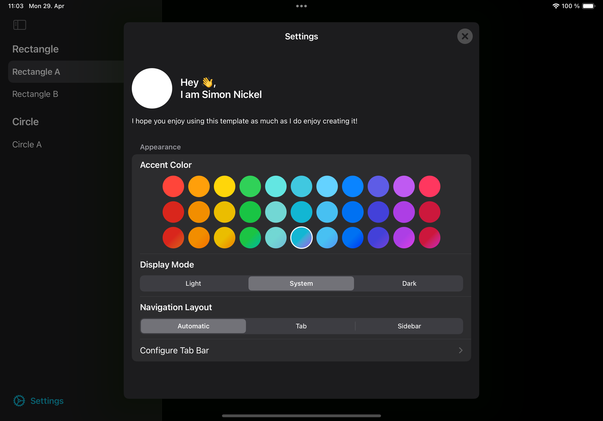

<!-- Copy badges from SPI -->

 

> This package is part of the [SNAP](https://github.com/simonnickel/snap) suite.

# SnapTemplate

Contains shared code and Demo Xcode project to setup and use SNAP in an iOS App. 

[![Documentation][documentation badge]][documentation] 

[documentation]: https://swiftpackageindex.com/simonnickel/snap-template/main/documentation/snaptemplate
[documentation badge]: https://img.shields.io/badge/Documentation-DocC-blue

## Requirements

- iOS 18+, macOS 15+
- Swift 6.3
- Dependencies: [snap-core](https://github.com/simonnickel/snap-core), [snap-dependencies](https://github.com/simonnickel/snap-dependencies), [snap-navigation](https://github.com/simonnickel/snap-navigation), [snap-settings-service](https://github.com/simonnickel/snap-settings-service), [snap-style](https://github.com/simonnickel/snap-style)

## Motivation

> Finishing the last 20% of a project takes 80% of the time.
>
> (Source: Someone on the internet)

The goal of SnapTemplate is to already have the last 20% ready, before you even start the project. The same applies to the first 20% of a project: infrastructure, boilerplate and project setup. 

Even if you don't plan to finish the last 60% of it, it allows to test a quick idea with a full app experience around it.

## Demo project

SnapTemplateDemo is an Xcode project with a base setup of [SNAP](https://github.com/simonnickel/snap). The app comes with structure, navigation and infrastructure prepared, to quickly setup a new app using the SNAP packages.

### Create new App

1. Create and clone repository.
2. Copy files from snap-app-template and get everything in the correct place.
3. Rename project.
    1. Rename top item in project navigator.
    2. Change bundle identifier.
4. Follow setup steps of [snap-settings-service](https://github.com/simonnickel/snap-settings-service#setup).

### Template

The Template comes with:
 
1. Infrastructure to define dependencies and configuration of SNAP packages ready to go.
2. Boilerplate to define a navigation hierarchy for the app using [snap-navigation](https://github.com/simonnickel/snap-navigation).
3. A base settings screen using [snap-settings-service](https://github.com/simonnickel/snap-settings-service) with some theme configuration options. A header and contact section are planned, see [TODO-1](docs/todo/todos.md).

### Configurations

#### Info.plist

Added `ITSAppUsesNonExemptEncryption` key with value `NO`, see: [Complying with Encryption Export Regulations](https://developer.apple.com/documentation/security/complying_with_encryption_export_regulations)

#### Build Settings

 - Set `Swift Language Version` to 6
 - Enabled Strict Concurrency checking: `SWIFT_STRICT_CONCURRENCY = complete;`
